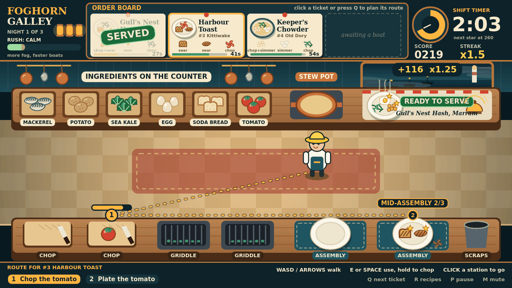

# Foghorn Galley

A cooking game set in the kitchen under a lighthouse: an entry for make.fun's
[Make the best cooking game](https://make.fun/bounty/best-cooking-game-20261125-0137) bounty.

Night boats call their orders in to the lighthouse galley. Read the order board, take ingredients
from the counter, chop them, sear them on the griddle or simmer them in the stew pot, build the dish
on an assembly plate and ring it out at the pass before the boat's patience runs out. Three nights,
six ingredients, six dishes, one shift timer.

## Play

Node 22.18 or later, nothing to install:

    node serve.ts

then open http://localhost:8080 in desktop Chrome. The game is plain static files under `game/`
and makes no network request.

| Key | Does |
| --- | --- |
| WASD or arrows | walk |
| E or Space | use the station in reach; hold at a board to keep chopping |
| click a station | walk there and use it |
| Q, or click a ticket | choose the ticket the route is planned for |
| R / P / M | recipe book / pause / mute |

## What makes it a game

- **A route to plan.** The dashed line on the floor is a real plan (`game/src/route.js`): what needs
  heat goes on first, you chop while it cooks, and cooked food comes off before it burns. Pick another
  ticket and the plan changes.
- **Recipes that share parts.** A chopped potato becomes a hash on the griddle or a chowder in the
  pot; an egg is fried for one dish and boiled for another. Prepare once, decide late.
- **Timing you can feel.** Lift food inside the green window for a perfect cook and a bonus; leave
  it and it burns. Carry raw food to a finished burner and the two swap in one move.
- **Pressure without chores.** Nothing to wash and nothing new to learn: as the fog thickens the
  boats arrive closer together and wait less, and three lost boats put the lanterns out.
- **Streaks.** Every dish served in a row multiplies the next, up to three times.

## How the source is laid out

| File | Job |
| --- | --- |
| `game/src/recipes.js` | ingredients, the six recipes, matching a plate against a recipe |
| `game/src/kitchen.js` | the floor plan: every station and where the cook stands to use it |
| `game/src/stations.js` | what each station does: crate, board, griddle, pot, plate, pass, bin |
| `game/src/orders.js` | the order board: tickets arriving, losing patience, being served |
| `game/src/rush.js` | how the pressure grows through a shift |
| `game/src/route.js` | the route planner |
| `game/src/score.js` | pay, tips, streak multiplier, stars |
| `game/src/cook.js` | walking and the use key |
| `game/src/shift.js` | one night's state and its step |
| `game/src/pilot.js` | the first mate: an autopilot that follows the plan (title demo, screenshots) |
| `game/src/draw-*.js` | the painters: food, kitchen, cook, HUD, screens |
| `game/src/audio.js` | every sound, synthesised with Web Audio |
| `game/src/shots.js` | the screenshot scenes |

All art is drawn on the canvas by the code above and all sound is synthesised; there are no image,
font or audio files.

## Screenshots

The four images in `screenshots/` are the game's own canvas, captured in headless Chromium at
1280 x 720 from the scenes in `shots.json` (for example `http://localhost:8080/?shot=service&seed=3`).
Each scene starts a real shift from its seed and lets the first mate cook it through the game's own
rules up to the moment shown, so the same seed gives the same frame.

## Hand-in

    mkdir -p out && MAKEFUN_OUTPUT_DIR=out node main.ts

copies `game/` and `screenshots/` to the output and writes `dossier.json` with the kit's
`vendor/makefun-game.ts`.

MIT licensed. Built with Claude Code.
